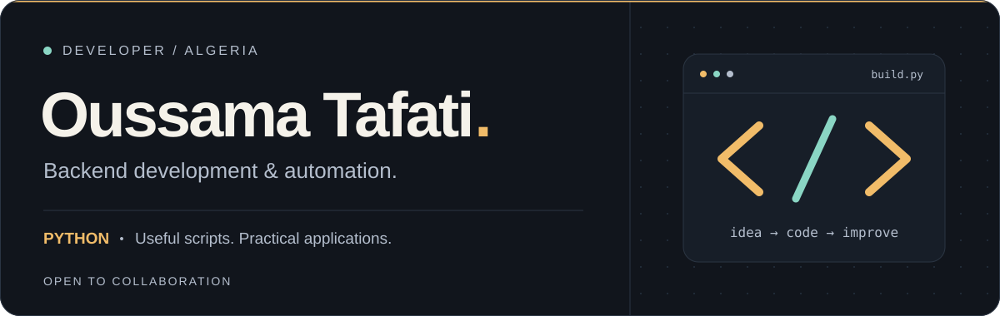

<picture>
  <source media="(prefers-color-scheme: dark)" srcset="./assets/header-dark.svg">
  <source media="(prefers-color-scheme: light)" srcset="./assets/header-light.svg">
  
</picture>

  <a href="https://www.linkedin.com/in/oussama-tafati/"><strong>LinkedIn</strong></a>
  &nbsp; / &nbsp;
  <a href="https://t.me/oussama_099"><strong>Telegram</strong></a>
  &nbsp; / &nbsp;
  <a href="https://github.com/oussama2006o?tab=repositories"><strong>Explore my work ↗</strong></a>

 

### A little about me

I'm **Oussama**, a Python developer based in **Algeria**. I focus on backend development, scripting, and automation, and I'm also building web applications with React and TypeScript.

I enjoy turning everyday problems into useful software, learning through projects, and collaborating on practical tools and open source.

### My toolkit

| Focus | Technologies |
| :--- | :--- |
| Backend & automation | **Python** · scripting |
| Web applications | **TypeScript** · React · Tailwind CSS |
| Data | MySQL · MongoDB · Firebase |
| Development | Git · Linux · Docker |

### Selected work

#### [Koléa Cosmetic ↗](https://github.com/oussama2006o/kolea.cosmitic-app)

A skincare and beauty storefront project with product browsing, a shopping cart, and an administration interface.

**React** · **TypeScript** · **Tailwind CSS** · **Firebase**

[Explore the source →](https://github.com/oussama2006o/kolea.cosmitic-app)

 

### Let's build something useful

Have a project in mind, an automation idea, or an open-source tool to work on? Reach out on [LinkedIn](https://www.linkedin.com/in/oussama-tafati/) or [Telegram](https://t.me/oussama_099).

  
Find me elsewhere

   
  <a href="https://www.instagram.com/oussama._.tft_/">Instagram</a>
  &nbsp; · &nbsp;
  <a href="https://web.facebook.com/oussama.tft.2025/photos">Facebook</a>

